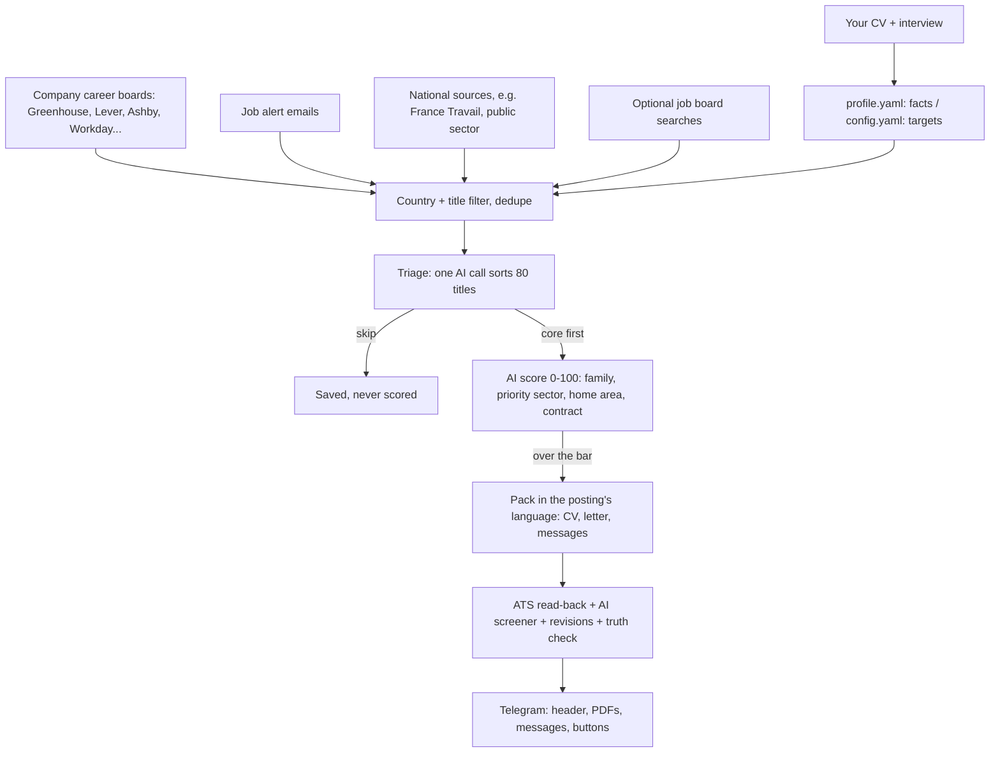

# Job Radar

[](https://github.com/aka1127/job-radar/actions/workflows/tests.yml)


An AI job-hunting engine for anyone, in any country and any field. Give it your CV and answer its interview;
every hour it watches company career boards and job sources in your country, sorts and scores every new posting
against your profile, and sends each good match to your phone with a **tailored, ATS-checked CV**, a cover letter
and the messages to send to the hiring manager. You read, apply and tap a button; it follows up.

<p align="center"></p>

It runs on your own machine and your own Claude account (through the Claude Code CLI): no API key, no server.

## What it does

- **Learns who you are.** `onboard` reads your CV, asks about your country, city, the jobs you want, your
  conditions, languages and best results, then asks follow-up questions about what the CV leaves vague. It writes
  your profile (the only source of facts it will ever use) and your search settings.
- **Finds the jobs.** Company career boards on Greenhouse, Lever, Ashby, Workday, SmartRecruiters, Teamtailor,
  Workable, Recruitee and Personio (read through the public APIs their own pages use, 1,200+ boards found
  automatically for France alone), any careers page with schema.org `JobPosting` data, job alert emails, optional
  job board searches, and national extras where they exist ([countries.md](docs/countries.md)).
- **Sorts them like a recruiter.** A free title filter, one quick AI call that sorts 80 titles at a time (core,
  possible, skip), then a full AI score 0-100 with your level, home area, contracts and priority sector in mind.
  Duplicates across boards and company spellings are caught before anything is sent.
- **Writes the application.** CV, cover letter, LinkedIn note, hiring-manager message and follow-up, in the
  posting's language (English, French, Spanish, German, Italian, Portuguese, Dutch), angled for the job's family:
  an account-management job and a project job get different CVs from the same profile.
- **Checks it like an ATS.** The PDF is read back the way applicant tracking systems read it (sections, titles,
  dates, keywords, characters, length), a separate AI call plays the company's resume screener, and up to two honest
  revisions follow. A truth check flags any number, tool or claim your profile does not back.
- **Delivers and tracks.** Three Telegram messages per job (header, CV and letter, messages to copy), buttons for
  *I applied*, *Got an interview*, *Got an offer*, a follow-up reminder a week later, a Monday summary. Send the bot
  any job link and it builds the pack for it.

<p align="center"></p>

## How it works



## Quick start

Python 3.12 or newer on Windows, macOS or Linux. [Claude Code](https://claude.com/claude-code) must be installed and
logged in once (`claude` in a terminal). Clone the repository into a short path on Windows (long paths break pip),
create a virtual environment in it (`.venv` is ignored by git and picked up by the scripts), then:

```bash
pip install -r requirements.txt -r requirements-dev.txt
```

```bash
python -m playwright install chromium
```

On Linux add `--with-deps` to that last command once, so Chromium gets its system libraries. Copy `.env.example` to
`.env` (secrets live there, never in git). Then onboard yourself (the interview takes about ten minutes, then Claude
writes your files):

```bash
python -m hunter onboard alex --cv path/to/cv.pdf
```

It writes `candidates/alex/profile.yaml` (the facts) and `config.yaml` (the targets), in the format of
[`candidates/example`](candidates/example), and checks them. Read both: the profile is the only source of facts the
engine will ever use; your conditions (salary floor, contracts, what to avoid) stay in the settings and never reach
a CV. To answer in a file instead of the terminal, pass `--answers` with a copy of
[docs/onboarding-answers.example.yaml](docs/onboarding-answers.example.yaml).

Connect Telegram ([TELEGRAM_SETUP.md](TELEGRAM_SETUP.md)), check everything, and find the company boards with jobs in
your country (the first refresh checks ~28,700 public boards and takes about an hour; the loop also discovers
career pages on its own every day):

```bash
python -m hunter telegram --who alex
```

```bash
python -m hunter doctor --who alex
```

```bash
python -m hunter boards --refresh --who alex
```

Then run it every hour, with the Telegram bot listening:

```bash
python -m hunter loop --who alex
```

On Windows, `.\scripts\install-task.ps1 -Who alex` installs it as a scheduled task with no window: it starts at
logon, restarts if it stops, and reloads itself when the code changes (only once the new code compiles). On macOS
or Linux, run `python -m hunter --who alex --log data/alex.log loop` under `nohup`, `tmux` or a systemd service.

## One engine, any person, any country

Nothing about a person or a country is in the code. Each person is a folder (see
[docs/configuration.md](docs/configuration.md) for every key):

| File | What it holds |
|---|---|
| `candidates/<name>/profile.yaml` | Facts: jobs, dates, facts per job, metrics, confirmed skills, education, languages, writing notes. |
| `candidates/<name>/config.yaml` | Targets: country, home and radius, CV languages, contracts, searches, title filters, score bars, job families and how each angles the CV, an optional priority sector. |
| `config.yaml` | Engine settings shared by everyone: models, pacing, caps, sources, and the brand (name, colors, texts). |

- **Country**: places are matched with GeoNames (every country, every city above 15,000 people, under their local
  and English names: München and Munich, Lisboa and Lisbon), the home area is every city within your radius,
  contracts are named the local way, and the scorer, screener and letters are told where you are. France has the
  most complete pack ([countries.md](docs/countries.md)).
- **Field**: job families, the title filters, the triage rules and the field's vocabulary come from your config,
  so an engineer, a nurse, a buyer and a designer each get their own.
- **Priority sector**: optional (healthcare for the example). Its core roles get a lower score bar, go first in the
  queue when they also pass the normal bar, and get their own look in Telegram and their own CV angle.

The fictional [example person](candidates/example) (Alex Moreau, Lyon, product designer with healthcare first) runs
the demo and the tests; `tests/test_world.py` moves them to Germany to prove nothing is French by default. Set
`HUNTER_HOME` to keep `candidates/`, `data/`, `output/` and `.env` outside the checkout.

## Make it yours

The look and the words live in one place, `brand:` and `texts:` in [config.yaml](config.yaml): the product name,
the CV palette, the badge color, the font, the priority look of the Telegram header, and every sentence the person
reads in Telegram (buttons, cards, help, weekly summary), so a translation or a rebrand is a config change. The
CV, letter and header templates are plain HTML and CSS in `templates/`.

## Truthful by design

- `profile.yaml` is the only source of facts. The AI may reword, reorder, select, translate and use the posting's
  vocabulary for what you really did; it never adds tools, numbers, employers, titles or dates.
- Titles, employers and dates are copied by code, never written by the AI.
- After writing, a check compares every number and tool on the CV with the profile; anything unbacked appears on
  the card as **Check before sending**.
- You apply and send every message yourself, on purpose: mass auto-applying gets accounts banned.

## Respectful by design

- Every web page a crawler opens is checked against the site's `robots.txt` first (`protego`), with pauses between
  pages and an honest user agent that names this project; a site that answers with a bot check is left alone for
  hours.
- Company boards are read through the public JSON APIs their own career pages use, within one time budget per run.
- Boards whose terms forbid scraping (LinkedIn, Indeed, Glassdoor, HelloWork) are **off by default**: their job
  alert emails bring the same jobs ([ALERTS_SETUP.md](ALERTS_SETUP.md)). Turning one on is the operator's choice and
  risk.

## Commands

| Command | What it does |
|---|---|
| `python -m hunter onboard <name> --cv cv.pdf` | New person: interview, profile and settings |
| `python -m hunter run --dry-run` | Search and filter only, no AI, nothing saved |
| `python -m hunter run --limit 3` | One full cycle, at most 3 packs |
| `python -m hunter loop` | Every hour, plus the Telegram bot |
| `python -m hunter apply <job link>` | Pack for one job link (also: send the link to the bot) |
| `python -m hunter boards --refresh` | Find company boards with jobs in the person's country |
| `python -m hunter companies add <careers URL>` | Watch a company's career page or feed |
| `python -m hunter archive` | What the archive of every posting seen holds |
| `python -m hunter usage` | Claude calls, minutes and tokens per day |
| `python -m hunter doctor` | Check the setup |

Add `--who <name>` when you run the engine for more than one person (the example does not count); `usage` and
`archive` need no person.

## Project layout

```
hunter/            the engine
  pipeline.py      one cycle: collect, filter, triage, score, pack, check, deliver
  llm.py           every Claude step (triage, score, pack, screener, revise, brief, discovery)
  onboard.py       CV + interview -> profile.yaml and config.yaml
  targets.py       country, home area, contracts, CV languages, families, priority, CV angle (from the config)
  geo.py           countries, cities, home areas (GeoNames)
  i18n.py          CV languages: section titles, months, letter date lines, language detection
  brand.py         the look and the words (defaults for config.yaml's brand: and texts:)
  careers.py       company career boards and feeds, robots.txt checks
  alerts.py        job alert emails (IMAP)
  sources.py       job board searches and France Travail
  archive.py       archive of every posting seen
  render.py, ats.py, docx_cv.py   designed and plain CVs, letters, ATS read-back
  notify.py, bot.py                Telegram delivery, buttons and job links
candidates/example the fictional example person
templates/         CV, letter and Telegram header (HTML + CSS, printed by Chromium)
tests/             offline test suite (boards, Telegram and Claude are faked)
.claude/agents/    Claude Code agents: ATS auditor, quantify coach, skeptical interviewer, French recruiter and scout
docs/              configuration, countries, onboarding answers, roadmap, French sources map
```

## Tests

```bash
python -m pytest
```

158 tests, offline and on the fictional example: Telegram, job boards and Claude are faked; CVs are rendered and
read back for real, in French, English and German. They run on Linux and Windows in GitHub Actions.

## Roadmap

One collector feeding several people, a small web dashboard installable on a phone, more CV languages and country
packs. See [docs/ROADMAP.md](docs/ROADMAP.md).

## Credits

[JobSpy](https://pypi.org/project/python-jobspy/) (MIT) for board searches, [geonamescache](https://pypi.org/project/geonamescache/)
(MIT) with [GeoNames](https://www.geonames.org) data (CC BY 4.0) for places, [protego](https://github.com/scrapy/protego)
(BSD) for robots.txt, [trafilatura](https://github.com/adbar/trafilatura) (Apache 2.0) for page text,
[Playwright](https://playwright.dev) for PDFs, the [Inter](https://rsms.me/inter/) font (OFL), the public ATS board
lists of [job-board-aggregator](https://github.com/Riley-Dorrington/job-board-aggregator) (MIT). Two Claude Code
agents are adapted from [resume-helper](https://github.com/MadeByTokens/resume-helper) (MIT) and the ATS formatting
skill comes from [ats-resume-skill](https://github.com/msdanyg/ats-resume-skill) (MIT).

## License

MIT (see [LICENSE](LICENSE); third-party parts are listed in [NOTICE.md](NOTICE.md)). Use it for your own job search
and respect each job site's terms.
