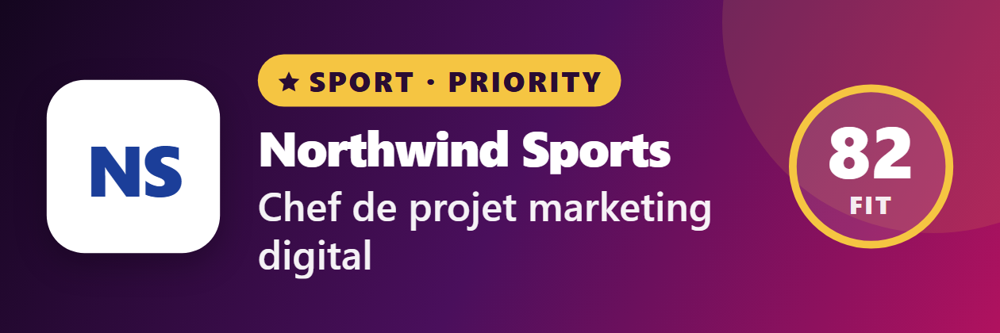
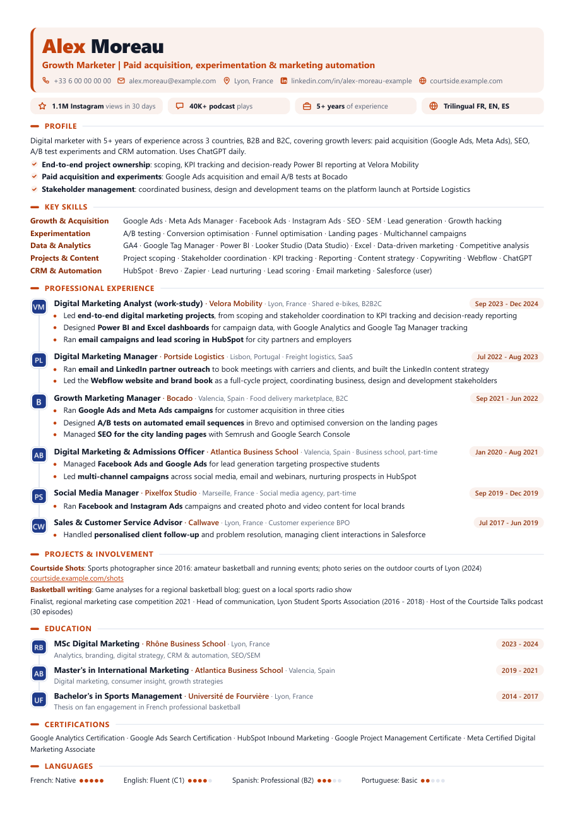
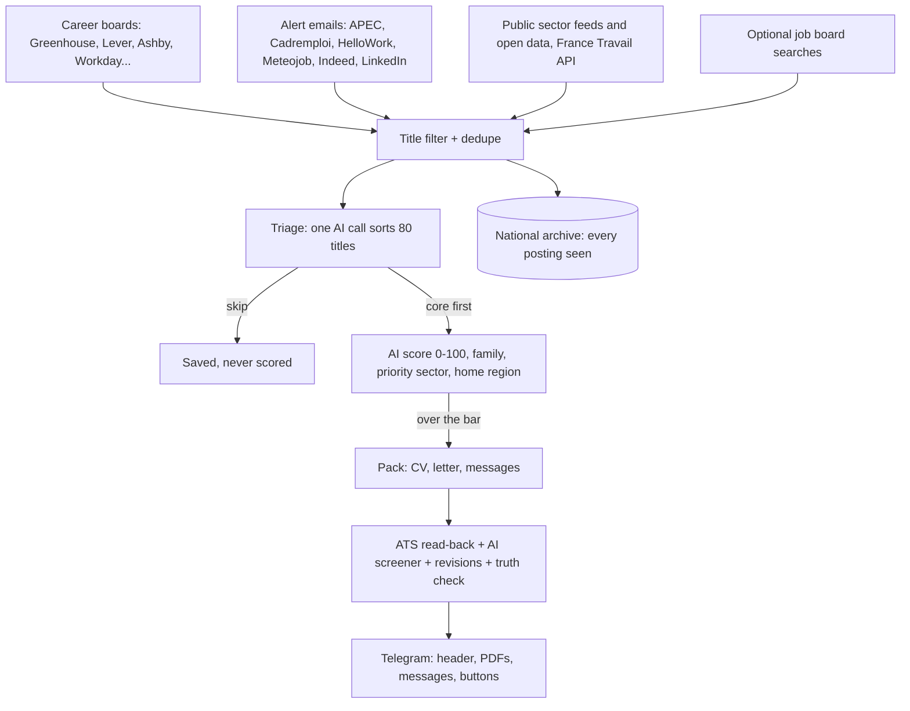

# Job Radar

[](https://github.com/aka1127/job-radar/actions/workflows/tests.yml)


An AI job-hunting engine for the French market. Give it a person's CV and what they want; every hour it watches
job sources and company career boards (**1,200+ with jobs in France**, found automatically in public ATS lists),
sorts and scores every new posting against that person, and
sends each good match to their phone with a **tailored, ATS-checked CV**, a cover letter and the messages to send
to the hiring manager. The person reads, applies and taps a button; the engine follows up.

<p align="center"></p>

It runs on your own machine and your own Claude account (through the Claude Code CLI): no API key, no server.

## What it does

- **Finds the jobs.** Company career boards on Greenhouse, Lever, Ashby, Workday, SmartRecruiters, Teamtailor,
  Workable, Recruitee and Personio (read through the public APIs their own pages use), Welcome to the Jungle,
  public-sector feeds and open data, sites with schema.org `JobPosting` data, job alert emails, France Travail's
  official API, and optionally the big boards.
- **Sorts them like a recruiter.** A cheap title filter, then one quick AI call sorts 80 titles at a time (core,
  possible, skip), then a full AI score 0-100 for the plausible ones, with the person's level, home region and
  priority sector in mind. Duplicates across boards and company spellings are caught before anything is sent.
- **Writes the application.** CV content, cover letter, LinkedIn note, hiring-manager message and follow-up, in
  the posting's language, angled for the job's family (a sales job and a content job get different CVs from the
  same profile).
- **Checks it like an ATS.** The PDF is read back the way applicant tracking systems read it (sections, titles,
  dates, keywords, characters, length), a separate AI call plays the company's resume screener, and up to two
  honest revisions follow. A truth check flags any number, tool or claim the profile does not back.
- **Delivers and tracks.** Three Telegram messages per job (header, CV and letter, messages to copy), buttons for
  *I applied*, *Got an interview*, *Got an offer*, a follow-up reminder a week later, a Monday summary. Send the bot
  any job link and it builds the pack for it.

<p align="center"></p>

## How it works



Every posting the engine sees, whatever its field, also lands in a national archive (`data/jobs.db`). It fills
fast: the State's public-sector open data alone brings about 280,000 offers a year, and the first instance passed
286,000 postings in its first days. It is the base for a future search product.

## Quick start

Python 3.12, Windows, macOS or Linux. Claude Code must be installed and logged in once (`claude` in a terminal).

```bash
pip install -r requirements.txt
```

```bash
python -m playwright install chromium
```

Create a person from their CV (answers to a few questions: home, target jobs, priority sector, contracts...):

```bash
python -m hunter onboard alex --cv path/to/cv.pdf --answers docs/onboarding-answers.example.yaml
```

Claude writes `candidates/alex/profile.yaml` (the facts) and `config.yaml` (the targets) in the format of
[`candidates/example`](candidates/example), checks them, and lists in `QUESTIONS.md` what would make the CV stronger.
Read both files: the profile is the only source of facts the engine will ever use.

Connect Telegram ([TELEGRAM_SETUP.md](TELEGRAM_SETUP.md)), then check everything and try one run without AI:

```bash
python -m hunter telegram --who alex
```

```bash
python -m hunter doctor --who alex
```

```bash
python -m hunter run --who alex --dry-run
```

Then run it for real, every hour, with the Telegram bot listening:

```bash
python -m hunter loop --who alex
```

On Windows, `.\scripts\install-task.ps1 -Who alex` installs it as a scheduled task with no window: it starts at
logon, restarts if it stops, and reloads itself when the code changes (only once the new code compiles).

## One engine, any person

Nothing about a person is in the code. Each person is a folder:

| File | What it holds |
|---|---|
| `candidates/<name>/profile.yaml` | Facts: jobs, dates, facts per job, metrics, confirmed skills, education, languages, writing notes. |
| `candidates/<name>/config.yaml` | Targets: home region, searches, title filters, score bars, job families and how each angles the CV, an optional priority sector, writing rules. |
| `config.yaml` | Shared engine settings: models, pacing, caps, sources. |

The fictional [example candidate](candidates/example) (Alex Moreau, Lyon, digital marketing with sport as the
priority sector) shows every option, runs the demo and the test suite.

A **priority sector** (sport for the example) gets a lower score bar for its core roles, goes first in the queue
when it also passes the normal bar, its own look in Telegram, and its own CV angle (projects block, creative tiles,
portfolio link).

## Truthful by design

- `profile.yaml` is the only source of facts. The AI may reword, reorder, select, translate and use the posting's
  vocabulary for what the person really did; it never adds tools, numbers, employers, titles or dates.
- Titles, employers and dates are copied by code, never written by the AI.
- After writing, a check compares every number and tool on the CV with the profile; anything unbacked appears on
  the card as **Check before sending**.
- The person applies and sends every message themselves, on purpose: mass auto-applying gets accounts banned.

## Respectful by design

- Every web page a crawler opens is checked against the site's `robots.txt` first (`protego`), with pauses between
  pages; a site that answers with a bot check is left alone for hours.
- Company boards are read through the public JSON APIs their own career pages use, within a time budget per run.
- Boards whose terms forbid scraping (LinkedIn, Indeed, Glassdoor, HelloWork) are **off by default**: their job
  alert emails bring the same jobs ([ALERTS_SETUP.md](ALERTS_SETUP.md)). Turning one on is the operator's choice
  and risk. The map of ~110 French job sources, with what each allows, is in
  [docs/job-boards-france.md](docs/job-boards-france.md).

## Commands

| Command | What it does |
|---|---|
| `python -m hunter onboard <name> --cv cv.pdf` | New person from a CV |
| `python -m hunter run --dry-run` | Search and filter only, no AI, nothing saved |
| `python -m hunter run --limit 3` | One full cycle, at most 3 packs |
| `python -m hunter loop` | Every hour, plus the Telegram bot |
| `python -m hunter apply <job link>` | Pack for one job link (also: send the link to the bot) |
| `python -m hunter companies add <careers URL>` | Watch a company's career page or feed |
| `python -m hunter boards --refresh` | Find company boards with jobs in France in public ATS lists |
| `python -m hunter archive` | What the national archive holds |
| `python -m hunter usage` | Claude calls, minutes and tokens per day |
| `python -m hunter doctor` | Check the setup |

Add `--who <name>` when there is more than one person.

## Project layout

```
hunter/            the engine
  pipeline.py      one cycle: collect, filter, triage, score, pack, check, deliver
  llm.py           every Claude step (triage, score, pack, screener, revise, brief, discovery)
  targets.py       home region, job families, priority sector, CV angle, all from the person's config
  onboard.py       CV + answers -> profile.yaml and config.yaml
  careers.py       company career boards and feeds, robots.txt checks
  alerts.py        job alert emails (IMAP)
  sources.py       job boards and France Travail
  archive.py       national archive of postings
  render.py, ats.py, docx_cv.py   designed and plain CVs, letters, ATS read-back
  notify.py, bot.py                Telegram delivery, buttons and job links
candidates/example the fictional example person
templates/         CV, letter and Telegram header (HTML + CSS, printed by Chromium)
tests/             offline test suite (boards, Telegram and Claude are faked)
.claude/agents/    Claude Code agents: French recruiter, ATS auditor, job-market scout, skeptical interviewer
docs/              sources map, roadmap, onboarding answers template
```

## Tests

```bash
python -m pytest
```

126 tests, offline and on the fictional example: Telegram, job boards and Claude are faked; CVs are rendered and
read back for real.

## Roadmap

One collector feeding several people, a small web dashboard installable on a phone, official sources first. See
[docs/ROADMAP.md](docs/ROADMAP.md).

## Credits

[JobSpy](https://pypi.org/project/python-jobspy/) (MIT) for board searches, [protego](https://github.com/scrapy/protego)
(BSD) for robots.txt, [trafilatura](https://github.com/adbar/trafilatura) (Apache 2.0) for page text,
[Playwright](https://playwright.dev) for PDFs, the [Inter](https://rsms.me/inter/) font (OFL), the public ATS board
lists of [job-board-aggregator](https://github.com/Riley-Dorrington/job-board-aggregator) (MIT). Two Claude Code
agents are adapted from [resume-helper](https://github.com/MadeByTokens/resume-helper) (MIT) and the ATS formatting
skill comes from [ats-resume-skill](https://github.com/msdanyg/ats-resume-skill) (MIT).

## License

MIT. Use it for your own job search and respect each job site's terms.
